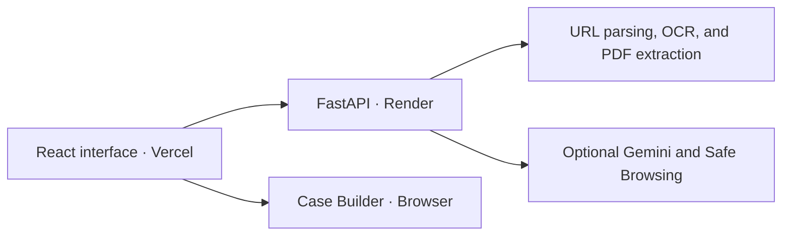

# 🛡️ FraudLens — Scam Evidence and Verification Workbench

<p align="center">
  <strong>Spot the warning signs. Verify your next step.</strong>
</p>

<p align="center">
  Investigate suspicious messages, screenshots, PDFs, and URLs. Trace findings back to their evidence and export a case report.
</p>

<p align="center">
  <a href="https://fraud-lens-two.vercel.app"></a>
</p>

<p align="center">
  
  
  
  
  
</p>

> FraudLens is an educational portfolio project. Its findings help you decide what to verify before sharing sensitive information or sending money. Sender identity and destination safety require independent verification.

## 📌 Overview

An unexpected delivery fee, an urgent account notice, or an advance-fee job offer can combine several clues across text, images, and links. FraudLens gives users one place to inspect those clues, record the supporting evidence, and identify what remains uncertain.

The React interface connects to a FastAPI backend for URL inspection, OCR, PDF extraction, and optional provider checks. Case Builder links findings to their sources and generates a plain-text report in the browser.

**Workflow** · Submit evidence → Review findings → Build a case → Verify independently → Export a report

## ✨ Highlights

- **Evidence-grounded message analysis** identifies warning signs in English or Hindi and verifies each quoted passage against the submitted text.
- **URL inspection** exposes the actual hostname, registrable domain, and structural warning signs without visiting the destination. Optional Safe Browsing checks require explicit consent.
- **Reviewed OCR and PDF extraction** lets users edit extracted text before submitting it for analysis.
- **Case Builder** groups evidence, distinguishes conflicts from observations made at different times, and lists practical verification steps.
- **Browser-based case handling** provides in-memory cases, opt-in device storage, and UTF-8 report downloads.

## 🖥️ Application Preview

Open the [live FraudLens app](https://fraud-lens-two.vercel.app), inspect `https://example.com/` in **URL Structure Inspection**, and check that the destination hostname reads `example.com`. Create a case, add the structural findings, and download the report.

The hosted frontend runs on **Vercel** and the FastAPI backend runs on **Render**. URL Structure Inspection was verified on the deployed site. Gemini analysis and Safe Browsing reputation checks are disabled on the public deployment and can be configured for the local walkthrough below.

## 🏗️ System Architecture



## Data Processing Boundaries

FraudLens strictly separates browser-only client operations, backend-local processing, and external cloud provider requests:

| Category | Capability | Execution Location | External Service Used | Execution & Network Scope |
|---|---|---|---|---|
| **External Cloud Services** | **Suspicious Message Analysis** | Backend (`FastAPI`) | **Google Gemini API** (`gemini-3.5-flash-lite`) | Transmits message text only within `<UNTRUSTED_MESSAGE>` prompt isolation delimiters. External search tools are disabled (`tools=None`), and the app requests `store=False`. |
| **External Cloud Services** | **URL Threat Reputation Check** | Backend (`FastAPI`) | **Google Safe Browsing** (`v4` Lookup API) | **Opt-in only**. Requires explicit user consent via an unchecked checkbox. Strips URL fragments (`#...`) before transmission and blocks private, loopback, and special-use domains. Never connects to the target website. |
| **Backend-Local Processing** | **URL Structure Inspection** | Backend (`FastAPI`) | **None** | **Executed on the local FraudLens backend without calling external providers**. Uses Python standard library and a bundled offline Public Suffix List snapshot (`tldextract`). Zero remote DNS queries, zero socket connections, and zero HTTP requests. |
| **Backend-Local Processing** | **Screenshot Text Extraction** | Backend (`FastAPI`) | **None** | **Executed on the local FraudLens backend without calling external providers**. Uses local Tesseract OCR and Pillow on the server. Images are uploaded to the FraudLens backend and are processed there without an external provider. Bounded by 5 MiB file size and 12 MP limits. |
| **Backend-Local Processing** | **PDF Document Extraction** | Backend (`FastAPI`) | **None** | **Executed on the local FraudLens backend without calling external providers**. Uses `pypdf` inside an isolated worker subprocess with a 256 MiB worker memory limit and a 20-second kill/reap timeout. Max 10 pages and 10,000 characters. |
| **Browser-Only Operations** | **Case Builder Workspace** | Frontend (`React`) | **None** | **Browser-only operation (zero server network transmission)**. Evidence items are aggregated in client React state. Refreshing the browser clears in-memory state. No external analytics, telemetry, or server persistence. |
| **Browser-Only Operations** | **Evidence-Linked Case Summary** | Frontend (`React`) | **None** | **Browser-only operation (zero server network transmission)**. Deterministic client-side rules synthesize warning signs, evaluate conflicts against strict criteria, compile unknowns, and suggest practical verification steps without API calls. |
| **Browser-Only Operations** | **Plain-Text Report Download** | Frontend (`React`) | **None** | **Browser-only operation (zero server network transmission)**. Compiles a clean UTF-8 `.txt` report directly in the browser via `Blob`. Triggers a local file download without sending data to any backend or cloud service. |
| **Browser-Only Operations** | **Local Case Persistence** | Frontend (`React`) | **None** | **Browser-only operation (zero server network transmission)**. Opt-in browser `localStorage` preserves one case across browser restarts only when explicitly requested. Validates schema before loading and recalculates reputation freshness upon reopening. |

---

## 🔍 End-to-End Walkthrough

Run this walkthrough locally with Gemini and Safe Browsing configured to follow a fictional delivery message from initial review to case export.

> **Important**: All data used in this walkthrough is purely synthetic and fictional. Never submit live financial credentials, active passwords, or sensitive personal data.

### Fictional Scenario
The user receives an unexpected SMS claiming a package is delayed due to an unpaid delivery redirection fee:
> *"URGENT: Package #US-88219 is on hold due to an unpaid $2.50 address redirection fee. Avoid return to sender by verifying your address and paying now: https://delivery-tracking.example.invalid/pay"*

---

### Step 1: Suspicious Message Risk Analysis (Calls Gemini API)
1. In the **Analyze Suspicious Message** section, paste the fictional text into the message textarea.
2. Select explanation language: **English** (or **हिन्दी**).
3. Click **Analyze Message**.
4. **Outcome**:
   - High-visibility **Warning Signs Detected** badge.
   - Identified categories: Urgency / High Pressure, Advance Fee Request, Credential / Payment Redirection.
   - **Verbatim Evidence Quotes**: Quotes `"$2.50 address redirection fee"` and `"verifying your address and paying now"`.
   - **Plain-Text URLs**: The destination URL is strictly rendered as monospace plain text, **never as a clickable HTML link**.
   - **Prominent Disclaimers**: Analysis explicitly states that findings evaluate submitted text only and do not verify sender identity or guarantee legitimacy.
5. Click **Add to Case** (or proceed to create a case first).

---

### Step 2: Case Creation & Collecting Evidence (Browser-Only / In-Memory)
1. Scroll down to the **Case Builder** section.
2. Enter the case name: `Fictional Delivery Fee Phishing SMS` and click **Create Case**.
3. The in-memory case is initialized with an empty state banner: *"No evidence items in this case yet. Inspect a URL or analyze a message to add findings."*
4. Return to the message analysis result and click **Add to Case**.
5. The analysis is added as **Evidence #1: [Message Analysis]**. The card displays the assessment, category, submitted text, verbatim warning signs, and timestamp.

---

### Step 3: Local URL Structure Inspection (Backend-Local Processing — No External Providers)
1. Locate the link from the message: `https://delivery-tracking.example.invalid/pay`.
2. In the **URL Structure Inspection** section, paste the URL into the input field.
3. Click **Inspect URL Structure**. (The request is processed on the local FraudLens backend without calling external providers or resolving remote DNS).
4. **Actual Output**:
   - **Destination Host**: Prominently isolated in a highlighted card as `delivery-tracking.example.invalid`.
   - **Registrable Domain (eTLD+1)**: Evaluated as `example.invalid` using the bundled offline Public Suffix List snapshot, which includes RFC 2606 reserved `.invalid` suffixes.
   - **Subdomains**: `delivery-tracking`.
   - **Scheme & Port**: `HTTPS` • Port: 443 (default), accompanied by the calibrated notice: *"HTTPS scheme — connection not checked"*.
   - **Structural Observations**: No structural anomalies detected (with the reminder that standard syntax alone does not prove the link is safe, authentic, or legitimate).
   - Submitted URL is displayed strictly as selectable plain text.
5. Click **Add to Case**.
6. The finding is saved as **Evidence #2: [URL Structure]**.

---

### Step 4: Optional Safe Browsing Demo (Calls Google Safe Browsing v4)
1. **Destination Boundary Notice**: If one were to submit `https://delivery-tracking.example.invalid/pay` for reputation checking, FraudLens's pre-flight host validation immediately rejects it with HTTP 422 `FORBIDDEN_DESTINATION` (`special_use_domain`). Local and reserved testing domains (such as `.invalid`, `.test`, `.example`, and private IPs) are never transmitted to external providers.
2. **Demonstrating Reputation with a Public Domain**: To demonstrate external threat reputation checking, enter the public domain **`https://example.com/`** separately in the URL input field.
3. Scroll to the **External Reputation (Google Safe Browsing)** panel.
4. Review the pre-flight URL preview: `https://example.com/` (confirming that any fragment `#...` would be stripped prior to transmission).
5. Check the explicit opt-in consent box:
   `[x] I consent to transmitting this destination URL to Google Safe Browsing to check for known threat matches.`
6. Click **Check Reputation (Safe Browsing)**.
7. **Outcome**:
   - Result: **No Known Threat Matches** (or threat categories if testing a known test vector).
   - Provider: Google Safe Browsing.
   - Mandatory Attribution: *"Data provided by Google Safe Browsing."*
   - Conspicuous Advisory: *"No known threat match does not guarantee that a link is safe or legitimate. New phishing and malware campaigns may not yet be indexed."*
   - Active freshness countdown (up to 30 minutes).
   - **Crucial Scope Clarification**: This reputation check evaluates and applies **strictly to `https://example.com/`**. It does **not** evaluate, vouch for, or guarantee safety for the fictional message link (`https://delivery-tracking.example.invalid/pay`).
8. Click **Add to Case**.
9. The result is added as **Evidence #3: [Safe Browsing Reputation]**.

---

### Step 5: Reviewing the Evidence-Linked Case Summary (Browser-Only Operation)
The **Case Summary** panel automatically synthesizes the saved evidence items in real time directly within the browser:
- **Warning Signs**:
  - Highlights the financial urgency and advance fee demand from the message text, linked directly to **Evidence #1** via clickable anchor links.
- **Conflicting Findings**:
  - Displays: *"No direct conflicts identified in the saved evidence."*
  - Clarifies: The "No Known Threat Matches" reputation check for `https://example.com/` (Evidence #3) evaluates that specific domain against known threat feeds only and does not contradict warning signs identified in the suspicious message text (Evidence #1) or structural observations of `https://delivery-tracking.example.invalid/pay` (Evidence #2).
- **What Remains Unknown**:
  - Highlights that the sender's phone number and identity remain unverified.
  - Notes that carrier delivery records cannot be confirmed through message analysis alone.
  - Notes that the reputation of the fictional link `https://delivery-tracking.example.invalid/pay` is not established by a clean lookup on `example.com`.
- **Practical Verification Steps**:
  - Recommends locating package tracking numbers independently through the carrier's official mobile application or verified website.
  - Advises contacting the delivery company directly using a phone number from an existing invoice or public directory, never via the SMS link.

---

### Step 6: Downloading the Plain-Text Case Report (Browser-Only Operation)
1. In Case Builder, click the **Download Case Report** button.
2. FraudLens compiles the active case and triggers a client-side download of `fictional-delivery-fee-phishing-sms-report.txt` generated directly in the browser via `Blob`.
3. The report file contains:
   - Header with case name, creation timestamp, and local export timestamp.
   - Confidentiality and data sensitivity notice.
   - All four summary sections (Warning Signs, Conflicting Findings, Unknowns, Verification Steps).
   - Numbered evidence reference section with complete, un-truncated plain-text quotes, inspected URLs, Safe Browsing attribution, and disclaimers.

```text
================================================================================
FRAUDLENS CASE INVESTIGATION REPORT
================================================================================
Case Name:      Fictional Delivery Fee Phishing SMS
Case Created:   2026-11-13T19:40:00.000Z
Exported At:    2026-11-13T19:45:12.345Z
Evidence Items: 3

CONFIDENTIALITY & SENSITIVITY NOTICE:
This report was generated locally in the browser from your active investigation
case. It contains saved evidence items in plain text, which may include sensitive
personal, credential, or financial details. Handle and store this file securely.
================================================================================

--------------------------------------------------------------------------------
1. WARNING SIGNS
--------------------------------------------------------------------------------
[Warning Sign 1] Advance Fee Demand
  Evidence Reference:   Evidence #1: Message Analysis (Warning Signs Detected)
  Detail:               Message demands an upfront fee ($2.50) to release a package.
  Evidence Quote (Plain Text): "unpaid $2.50 address redirection fee"

--------------------------------------------------------------------------------
2. CONFLICTING FINDINGS
--------------------------------------------------------------------------------
No direct conflicts identified in the saved evidence.
(Note: A 'No Known Threat Matches' reputation lookup evaluates threat feed inclusion only
and does not contradict warning signs in message text or structural URL inspection.)

--------------------------------------------------------------------------------
3. WHAT REMAINS UNKNOWN
--------------------------------------------------------------------------------
[Unknown 1] Sender Identity Unverified
  Description:          Analysis evaluates message text only and cannot confirm the sender's true identity.

--------------------------------------------------------------------------------
4. PRACTICAL VERIFICATION STEPS
--------------------------------------------------------------------------------
1. Do not submit payment or address details via unsolicited text message links.
2. Check your tracking number directly on the carrier's official website or app.
3. Call the carrier using a verified phone number from an official invoice.

--------------------------------------------------------------------------------
5. NUMBERED EVIDENCE REFERENCES
--------------------------------------------------------------------------------
Evidence #1: [Suspicious Message Analysis] Message Analysis (Warning Signs Detected)
  Evidence ID:          ev-msg-1
  Added At:             2026-11-13T19:41:00.000Z
  Source Type:          text_analysis
  Assessment:           warning_signs_found
  Category:             Financial / Phishing
  Summary:              Message contains urgency triggers and advance fee requests.
  Submitted Message Text (Plain Text):
  --- BEGIN SUBMITTED MESSAGE TEXT ---
  URGENT: Package #US-88219 is on hold due to an unpaid $2.50 address redirection fee. Avoid return to sender by verifying your address and paying now: https://delivery-tracking.example.invalid/pay
  --- END SUBMITTED MESSAGE TEXT ---

Evidence #2: [URL Structure Inspection] URL Structure: delivery-tracking.example.invalid
  Evidence ID:          ev-url-2
  Added At:             2026-11-13T19:42:30.000Z
  Source Type:          url_structure
  Submitted URL (Plain Text): https://delivery-tracking.example.invalid/pay
  Hostname:             delivery-tracking.example.invalid
  Scheme:               https
  Path:                 /pay
  Summary:              Destination host: delivery-tracking.example.invalid
  Inspection Basis:     URL structure only (evaluated on FraudLens backend without calling external providers)

Evidence #3: [URL Threat Reputation (Google Safe Browsing)] Safe Browsing: No Known Threat Matches
  Evidence ID:          ev-rep-3
  Added At:             2026-11-13T19:44:00.000Z
  Source Type:          url_reputation
  Checked URL (Plain Text): https://example.com/
  Reputation Outcome:   NO KNOWN MATCH
  Provider:             Google Safe Browsing
  Attribution:          Data provided by Google Safe Browsing.
  Advisory / Disclaimer: A 'No Known Threat Matches' lookup evaluates threat feed inclusion only and does not guarantee that the destination is safe, benign, or authentic. (Result applies strictly to https://example.com/).
================================================================================
END OF REPORT - FRAUDLENS
================================================================================
```

---

### Step 7: Opt-In Local Case Saving & Reopening (Browser-Only Operation / Storage)
1. **In-Memory Default**: By default, cases exist only in browser memory. A prominent badge reminds the user: *"In-Memory Storage Only: Cases exist in browser memory only and are cleared on refresh unless saved on this device."*
2. **Opt-in Save**:
   - Click **Save on This Device**.
   - An explicit confirmation dialog appears with a sensitivity disclosure:
     > *"This case and its evidence may contain sensitive personal or financial information. Saving will store it in this browser profile (localStorage) on this device, where it will remain accessible after refreshing the page."*
   - Click **Confirm & Save on This Device**.
   - A success banner confirms: *"Case saved on this device. It will remain in this browser profile."*
3. **Reopening After Refresh**:
   - Refresh the browser page (`F5` or `Ctrl + R`).
   - The active in-memory case is cleared, but a **Reopen Saved Case** banner appears showing the saved case name, creation time, and evidence count.
   - Click **Reopen Saved Case**.
   - The case is restored in memory, and reputation evidence freshness is immediately recalculated against the current time.
4. **Independent Deletion**:
   - Clicking **Delete Saved Case** removes the stored copy from `localStorage` while keeping the active in-memory case open for further review.

---

## 🔐 Engineering Decisions

### A. Defensive Prompt & AI Pipeline Isolation
- **Payload Isolation**: Untrusted user text is strictly bounded within `<UNTRUSTED_MESSAGE>` payload delimiters.
- **System Instruction**: Delivered via Google GenAI `GenerateContentConfig(system_instruction=...)`, instructing the model to treat the text as passive evidence and ignore embedded commands.
- **Strict Verbatim Grounding**: Every cited `evidence_quote` is validated on the backend to be an exact verbatim substring of the submitted text (`quote in submitted_text`). Fabricated or hallucinated quotes result in immediate rejection (`INVALID_RESPONSE`).
- **Plain-Text URLs Everywhere**: URLs found in messages, extracted text, or inspections are strictly rendered in monospace plain-text blocks with `break-all`, never as clickable `<a>` links.
- **Cross-Field Invariants**: `warning_signs_found` requires $\ge 1$ warning sign; `no_clear_warning_signs` strictly enforces zero warning signs.
- **Language Alignment**: The output `language` tag must match the requested language (`en` or `hi`).

### B. Local Screenshot Text Extraction (Tesseract OCR)
- **Local Backend Processing (No External Providers)**: Screenshots are processed locally on the FraudLens backend using Tesseract OCR and Pillow (`PIL`). On the hosted app, images travel to the FraudLens backend over HTTPS. OCR runs on that backend.
- **MIME & Decompression Bomb Protection**: Accepts strictly PNG and JPEG, verified via file headers. Caps decoded image size at 12 megapixels (`12,000,000` pixels) and file size at 5 MiB. Multi-frame GIFs, animated PNGs, and TIFFs are rejected.
- **Subprocess Isolation**: 20-second execution timeout with process kill (`proc.kill()`) and child process reaping (`await proc.wait()`). Concurrency bounded by `asyncio.Semaphore(3)`.
- **Human-in-the-Loop Confirmation**: Extracted text is presented in an editable review area with character counters. The user must review and check a confirmation box before text can be transferred to analysis. Any edit to the text immediately unchecks the box.

### C. Local PDF Document Extraction (`pypdf`)
- **Local Backend Processing (No External Providers)**: PDF parsing executes on the FraudLens backend in an independent worker subprocess (`app.services.pdf_worker`) managed by `_SyncDocumentRunner`.
- **Enforceable Memory Ceiling**: Sets a 256 MiB limit per worker before PDF parsing. Windows uses Job Objects to cap committed memory, and Linux uses `RLIMIT_AS` to cap virtual address space.
- **Resource Limits**: Strict 10-page limit (`MAX_DOCUMENT_PAGES = 10`), 10,000-character extraction cap, and 20-second timeout with process kill and reaping.
- **Security Protections**: Pure-Python reader does not execute PDF JavaScript, does not open embedded file attachments, does not follow external URIs, and does not render visual raster graphics.

### D. Backend-Local URL Structure Inspection (No External Providers)
- **Local Backend Processing**: URL structural inspection executes on the FraudLens backend without calling external providers, resolving remote DNS, opening sockets, or sending HTTP/WHOIS requests.
- **Public Suffix List Derivation**: Uses `tldextract` with a bundled offline snapshot of the Public Suffix List (runtime network downloads strictly disabled via `suffix_list_urls=()`). Reliably derives multi-part registrable domains (e.g. `example.co.uk`, `portal.gov.in`) and recognizes RFC 2606 reserved suffixes (`.invalid`, `.test`, `.example`).
- **Structural Observations**: Flags credentials before `@` in netloc (`userinfo_present`), direct IP address destinations (`ip_literal_host`), deep subdomain hierarchies ($\ge 3$ levels), unencrypted HTTP, and non-default ports.

### E. Optional Google Safe Browsing URL Reputation (v4 Lookup)
- **Explicit Opt-In**: Requires an explicit user consent checkbox before any URL is transmitted.
- **Sanitization & SSRF Defense**: URL fragments (`#...`) are stripped before transmission. Private, loopback, link-local, and reserved/special-use domains (such as `.invalid`) are rejected with HTTP 422 `FORBIDDEN_DESTINATION`.
- **Verified Local Setup**: Uses Google Safe Browsing `v4` Lookup JSON protocol (`POST /v4/threatMatches:find`).
- **Fail-Closed Handling**: Binary Protobuf responses (e.g., from v5) safely fail closed with HTTP 200 `status="unavailable"` and `error_code="MALFORMED_PROVIDER_RESPONSE"`.
- **Freshness Bounds**: Empty no-match responses return `expires_at=null` (no invented default cache) and stay out of backend cache. Threat matches use provider-indicated `cacheDuration`. Maximum warning freshness is capped at 30 minutes.

### F. Case Builder & Evidence Synthesis
- **Evidence Management**: Aggregates 4 distinct evidence types (`text_analysis`, `extracted_text`, `url_structure`, `url_reputation`), preserving source timestamps, raw payloads, and plain-text URLs.
- **Strict Conflict Rules**: A conflict is only flagged when two findings make incompatible claims about the exact same subject under comparable conditions. Differing assessments of different messages are not conflicts. A Safe Browsing no-match and threat match for the same URL do not conflict if performed at different times; they are classified as temporal observations.
- **Unknowns & Verification Steps**: Rule-based deduction extracts missing context (e.g., missing identity checks, expired reputation findings) and provides actionable, offline verification steps.

### G. Opt-In Local Case Storage & Report Export
- **In-Memory by Default**: New cases exist only in React state and are cleared on page refresh.
- **Storage Sensitivity Warning**: "Save on This Device" displays a prominent disclosure before writing to `localStorage`.
- **Schema Validation**: `validateSavedCase()` validates all fields and evidence payloads against strict type checks, rejecting corrupted or tampered storage data.
- **Freshness Recalculation**: On reopening a saved case, `recalculateCaseFreshness()` re-evaluates reputation freshness against the current system clock.
- **Plain-Text Export**: `downloadCaseReport()` generates a UTF-8 `.txt` report locally via `Blob` without network requests.

---

## 🛠️ Tech Stack

### Backend
- **Python**: 3.12+
- **Framework**: FastAPI 0.115+, Uvicorn 0.34+ (ASGI Server)
- **Validation**: Pydantic v2
- **AI SDK**: `google-genai` (version 2.33.0)
- **PDF Extraction**: `pypdf` (version 5.9.0)
- **Domain Parsing**: `tldextract` (version 5.4.0, bundled offline snapshot), `idna` (version 3.20)
- **OCR Engine**: Tesseract OCR (UB-Mannheim v5.x) + `Pillow` (PIL)
- **Testing**: `pytest`, `pytest-asyncio`, `httpx`

### Frontend
- **Framework**: React 18
- **Language**: TypeScript (strict mode enabled)
- **Styling**: TailwindCSS
- **Build Tool**: Vite 6
- **Testing**: Vitest, React Testing Library, jsdom
- **Code Quality**: ESLint v9 (React Hooks, TypeScript rules)

---

## ⚙️ Run Locally

> **Important**: Never paste API keys into terminal command lines or version-controlled files. Keep credentials strictly in `backend/.env`.

### Step 1: Install dependencies and configure the backend

Use Python 3.12, Node.js with npm, and Git. In PowerShell:

```powershell
git clone https://github.com/Anav-000/FraudLens.git
Set-Location FraudLens
py -3.12 -m venv backend\.venv
.\backend\.venv\Scripts\python.exe -m pip install -r backend\requirements.txt
npm --prefix frontend install
```

From the repository root:
```powershell
if (-not (Test-Path backend\.env)) {
    Copy-Item backend\.env.example backend\.env
}
notepad.exe backend\.env
```

Set the following configuration values:
```env
ENVIRONMENT=development
ALLOWED_ORIGINS=http://localhost:5173,http://127.0.0.1:5173

# AI Analysis Configuration
AI_PROVIDER=gemini
AI_MODEL=gemini-3.5-flash-lite
AI_API_KEY=YOUR_ACTUAL_GEMINI_API_KEY_HERE

# URL Reputation Configuration (Verified Local Setup: v4)
SAFE_BROWSING_VERSION=v4
SAFE_BROWSING_API_KEY=YOUR_ACTUAL_SAFE_BROWSING_API_KEY_HERE
```
Save (`Ctrl + S`) and close Notepad.

`backend/.env` is ignored by Git.

---

### Step 2: (Optional) Install Tesseract-OCR for Screenshot Extraction
If you wish to test local screenshot OCR:
1. Download the Windows installer from UB-Mannheim: https://github.com/UB-Mannheim/tesseract/wiki
2. Run the installer (e.g. `tesseract-ocr-w64-setup-5.5.0.exe`).
3. Under **Components to install**, expand **Additional language data** and select **Hindi**.
4. Complete installation to `C:\Program Files\Tesseract-OCR\tesseract.exe`.
5. Verify in PowerShell:
   ```powershell
   & "C:\Program Files\Tesseract-OCR\tesseract.exe" --version
   ```
*(If Tesseract is not installed, FraudLens continues to work normally for text analysis and URL inspection, truthfully reporting `screenshot_extraction: false` in capabilities).*

---

### Step 3: Run the Synthetic Smoke Test (CLI)
Verify your Gemini API key and live model connectivity out-of-band using the safe synthetic test:
```powershell
Set-Location backend
.\.venv\Scripts\python.exe -m scripts.check_gemini
```

Expected output:
```text
==================================================
FraudLens — Synthetic Gemini Connectivity Verification
==================================================
Provider: gemini
Model ID: gemini-3.5-flash-lite
--------------------------------------------------
Result: SUCCESS
Elapsed Time: ~1.8s
Schema Validation: PASSED (Devanagari Script: Yes)
Connectivity check complete. No user evidence was submitted or retained.
```
*(Note: `scripts.check_gemini` verifies live Gemini connectivity and API credentials out-of-band using harmless synthetic prompts. It does not submit user evidence).*

---

### Step 4: Start the Applications Locally

Open both terminals at the repository root.

#### Terminal 1: Backend Server (FastAPI)
```powershell
Set-Location backend
.\.venv\Scripts\python.exe -m uvicorn app.main:app --host 127.0.0.1 --port 8000 --reload
```

#### Terminal 2: Frontend Server (Vite)
```powershell
Set-Location frontend
npm run dev
```

Open your browser to: **`http://127.0.0.1:5173`**

---

## 🧪 Testing and Verification

FraudLens includes an extensive offline test suite covering unit, contract, integration, and security boundaries.

### Automated Test Execution Commands

```powershell
# 1. Run all backend tests offline (pytest)
.\backend\.venv\Scripts\python.exe -m pytest -c backend\pytest.ini backend\tests -v

# 2. Run all frontend unit and integration tests (Vitest)
Set-Location frontend
npm test

# 3. Strict TypeScript type check
npx tsc -b

# 4. ESLint code quality checks
npm run lint

# 5. Production bundle build
npm run build
```

### Verified Test Results

| Test Suite | Scope | Target | Result | Status |
|---|---|---|---|---|
| **Backend Suite (`pytest`)** | Unit, contract, security, and router tests | 362 tests across 13 test files | **362 passed, 20 warnings** in ~74s | **PASS** |
| **Frontend Suite (`vitest`)** | Components, integration, storage, and export tests | 120 tests across 10 test files | **120 passed, 0 failed** in ~52s | **PASS** |
| **Type Checking (`tsc -b`)** | Strict TypeScript compilation | All components, utilities, and tests | **0 errors** | **PASS** |
| **Linting (`eslint .`)** | Code style, hooks rules, and type safety | Entire frontend codebase | **0 errors, 0 warnings** | **PASS** |
| **Production Build (`vite build`)** | Minified production bundle | `dist/` bundle generation | **Build passed** | **PASS** |

### Verified Manual Browser Checks
1. **Successful v4 No-Match Freshness**: With `SAFE_BROWSING_VERSION=v4`, checking `example.com` in the browser displayed **"No Known Threat Matches"** with the Google Safe Browsing attribution and non-guarantee advisory, **without an immediate expiry banner**.
2. **Dynamic URL Modification Staleness**: Modifying the inspected URL immediately revoked consent and flagged previous reputation results as **stale**.
3. **End-to-End Case Workflow**: Created a case, added message analysis, URL structure, and URL reputation evidence items, verified Case Summary synthesis, downloaded the `.txt` report, saved the case locally, refreshed the page, and reopened the saved case with recalculation of freshness.

### Test Environment & Connectivity Disclosure
- **Offline Automated Tests**: Automated test suites (`pytest` and `vitest`) run entirely offline using recorded fixtures and mock transports. The automated Safe Browsing tests used mocks and fixtures; no live requests to Google Safe Browsing are made during automated test suite runs to avoid external dependencies, rate limits, and data egress.
- **Out-of-Band Gemini Verification**: Live Gemini API connectivity and API credentials were confirmed out-of-band using the synthetic CLI check (`scripts.check_gemini`).

---

## Privacy and Limitations

1. **Plain-Text URLs**: FraudLens strictly displays user-submitted URLs as plain text monospace strings. They are never rendered as clickable `<a>` links to prevent accidental navigation to malicious targets.
2. **No Guarantee of Safety**: FraudLens makes clear that "No known threat match" and "No clear warning signs" do **not** guarantee that a message, sender, or destination link is legitimate. New or targeted phishing attacks may not yet be indexed.
3. **Opt-In External Transmissions**: Network requests to external services (Gemini API and Google Safe Browsing) require explicit user action and consent. The user is warned before external transmission occurs.
4. **Browser-Only Operations & Backend-Local Processing**: Case Builder, Case Summary, report download, and local case persistence are strictly browser-only operations that make zero requests to any server. Screenshot OCR, PDF document extraction, and URL structural inspection use the local FraudLens backend without calling external providers or resolving remote DNS.
5. **In-Memory Storage by Default**: Cases exist only in memory unless the user explicitly opts into local device storage (`localStorage`). A clear disclosure is presented before saving.
6. **Free-Tier Data Boundary**: Prompts submitted via Google AI Studio free tier may be processed according to Google's terms. Never submit real financial credentials or personally identifiable information (PII).

---

## Troubleshooting

### 1. Backend Returns HTTP 503 `AI_CONFIGURATION_MISSING`
- Verify that `backend\.env` exists and contains `AI_PROVIDER=gemini` and `AI_API_KEY=AIza...`.

### 2. URL Reputation Returns HTTP 503 `SAFE_BROWSING_NOT_CONFIGURED`
- Ensure `SAFE_BROWSING_API_KEY` is populated and `SAFE_BROWSING_VERSION=v4` is set in `backend\.env`.
- Offline URL structure inspection remains fully operational on the local backend even when Safe Browsing is not configured.

### 3. Screenshot OCR Reports `OCR_UNAVAILABLE`
- Tesseract OCR is not installed or not in system PATH. Install Tesseract-OCR v5.x or set `TESSERACT_CMD` in `backend\.env`. Direct text pasting and URL inspection continue to function normally.

### 4. Port 8000 or 5173 Already in Use
- Check active port listeners in PowerShell:
  ```powershell
  Get-NetTCPConnection -LocalPort 8000 -ErrorAction SilentlyContinue
  ```
- To start the backend on port 8001:
  ```powershell
  .\.venv\Scripts\python.exe -m uvicorn app.main:app --host 127.0.0.1 --port 8001 --reload
  ```
  Then set `VITE_API_BASE_URL=http://127.0.0.1:8001` in `frontend/.env`.

## 👨‍💻 Author

**Arnav Kumar** · [GitHub](https://github.com/Anav-000)

## License

This project is developed for educational and portfolio demonstration purposes. All rights reserved. Google Safe Browsing and Google Gemini are trademarks of Google LLC.
